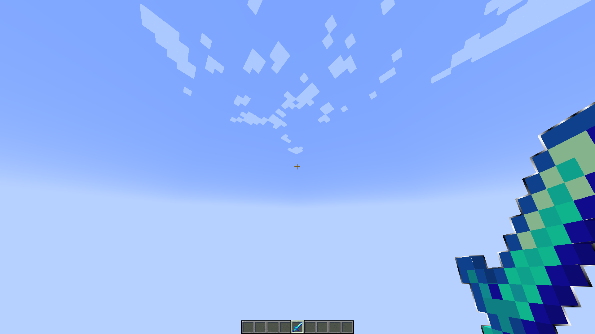
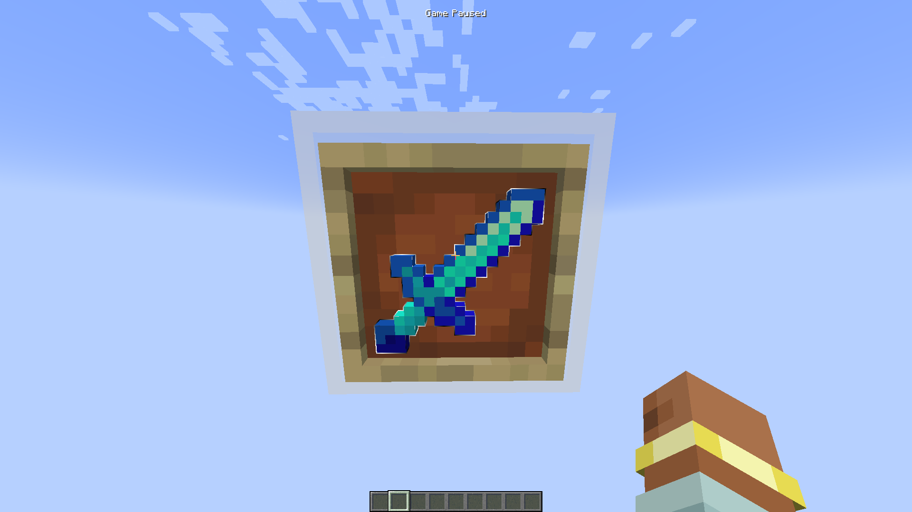
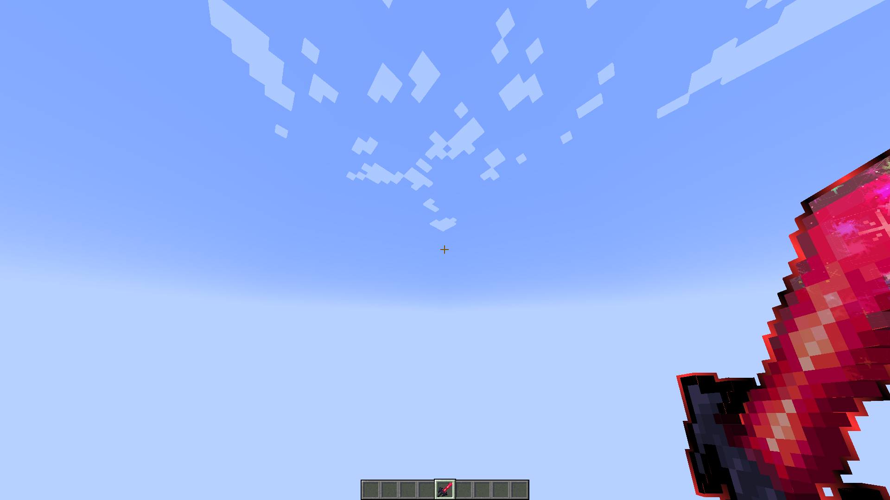
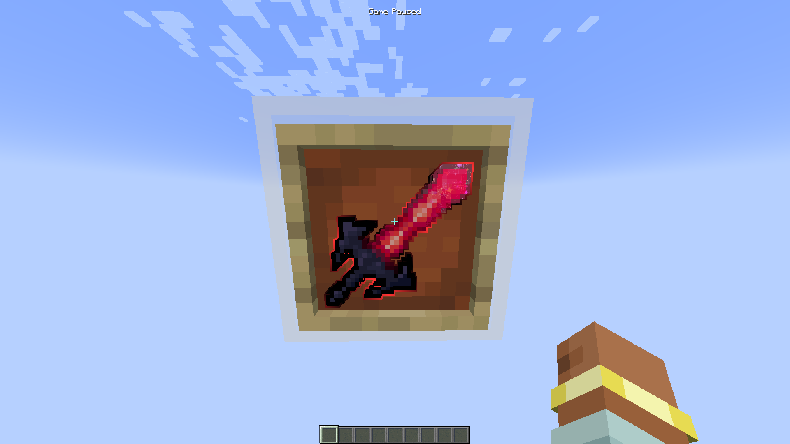
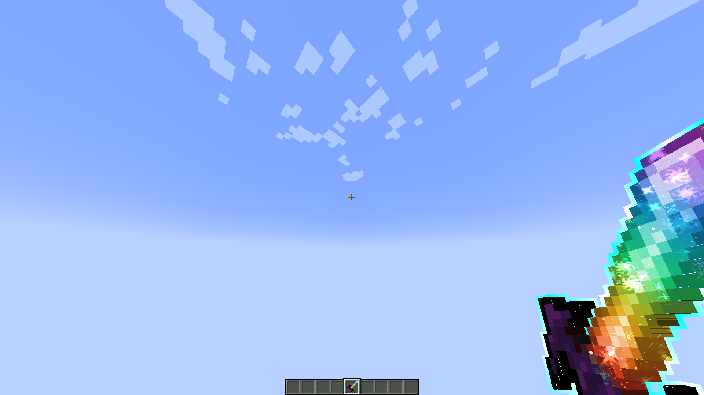
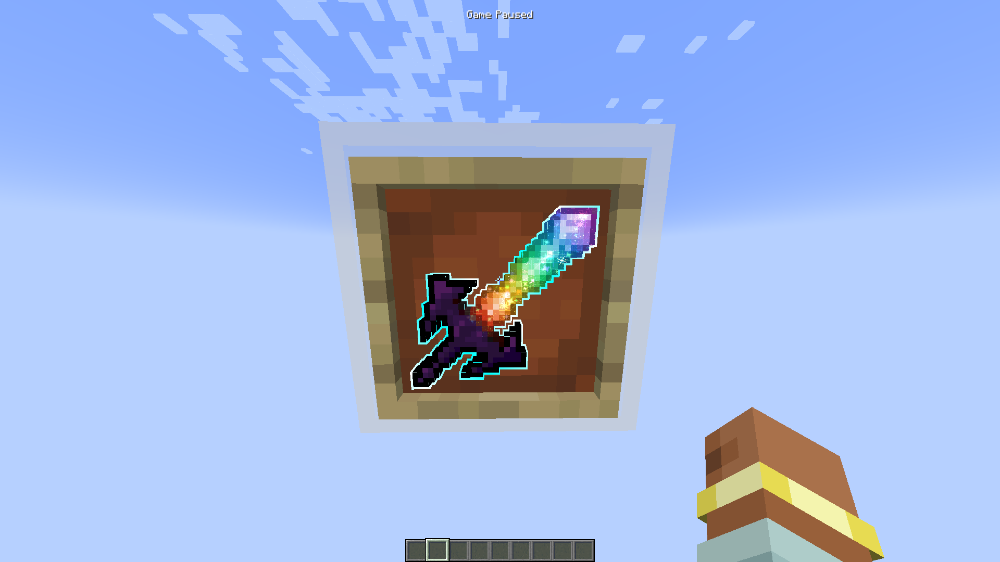
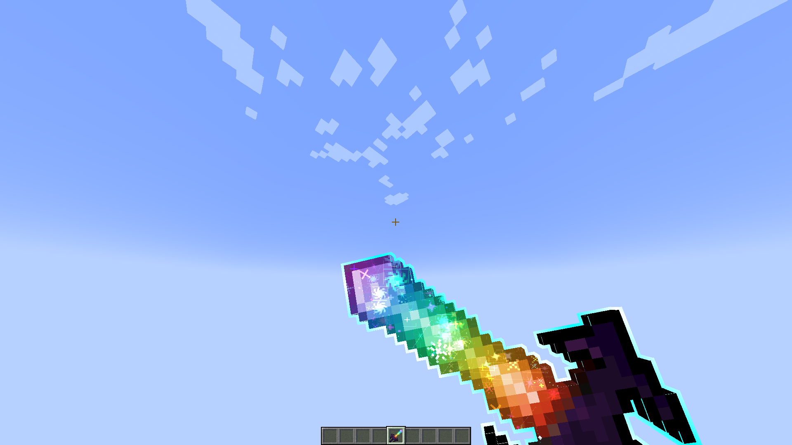
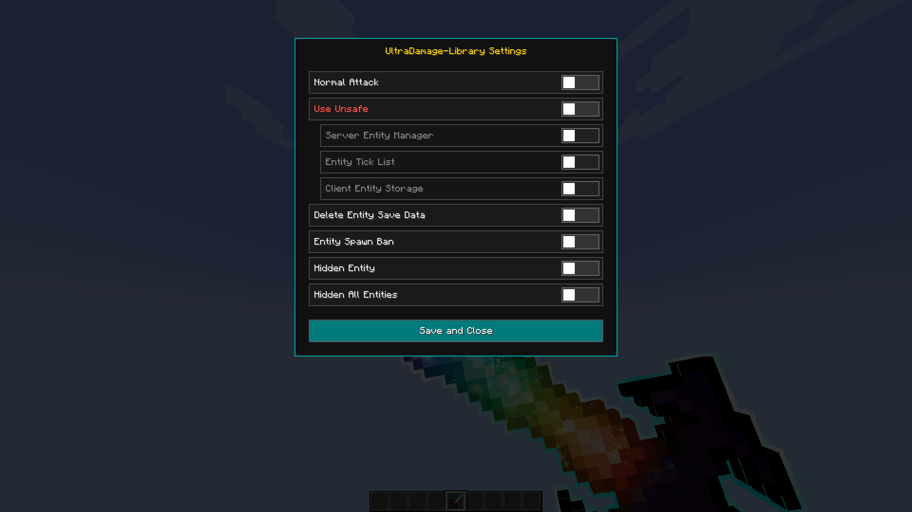
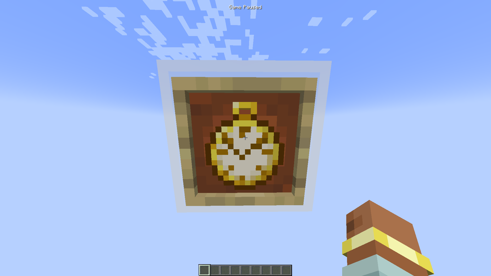

# Ultra Damage Library
このMODはライブラリではありません :D

CosmicRenderer from NOBTG 
GlowEdge from Luoee (Arcane Vortex)  作者の承諾を得て利用

Todo: https://github.com/users/zenith-kamo/projects/1
---
## 機能
### /udlコマンド
- remove - エンティティを削除する
- removeAll - 全てのエンティティを削除する
- storageRemove - ストレージからエンティティを削除する
- getAllEntities - 全てのエンティティを取得する
- theWorld - 時を止める

### Debug Sword

デバッグ用の剣です。

  
   
  手に持った状態

アイテム全体のプレビュー

  

---

### End Of Life

**すべての終焉。**

エンティティの体力を強制的にゼロにする強力な剣です。

  
   
  手に持った状態

アイテム全体のプレビュー

  

---

### UDL Sword

Ultra Damage Libraryの剣です。

  
   
  手に持った状態

アイテム全体のプレビュー

  

#### 右クリック時の動作

  

#### 設定メニュー

  

---

### Zenith's Pocket Watch

時を止める懐中時計です。

  
   
  手に持った状態

---

## License

See the repository's license files for licensing information.

並みの強さ